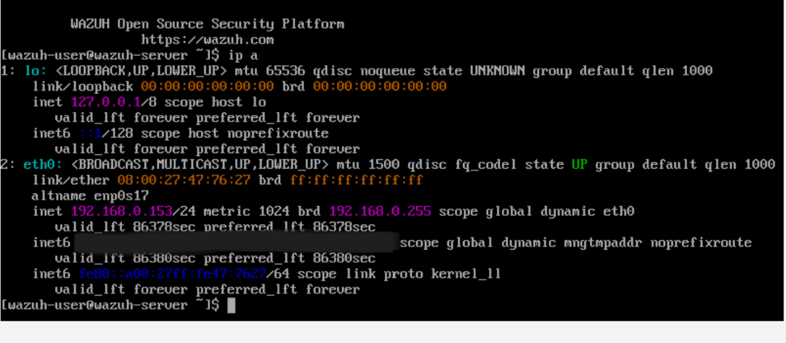
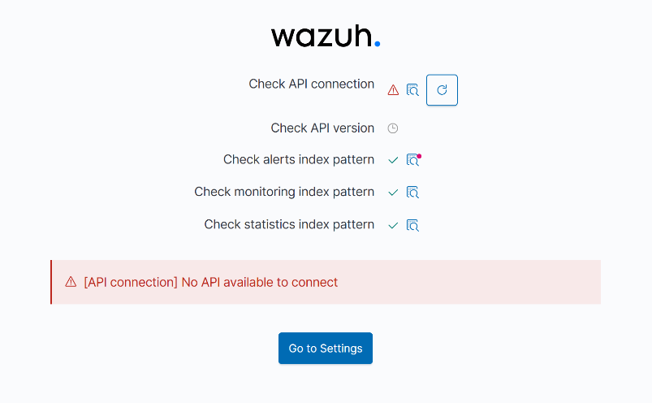
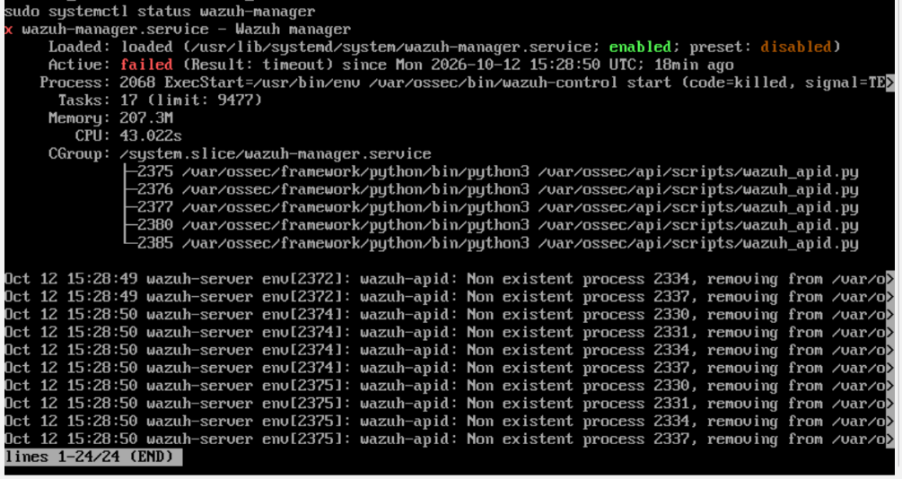
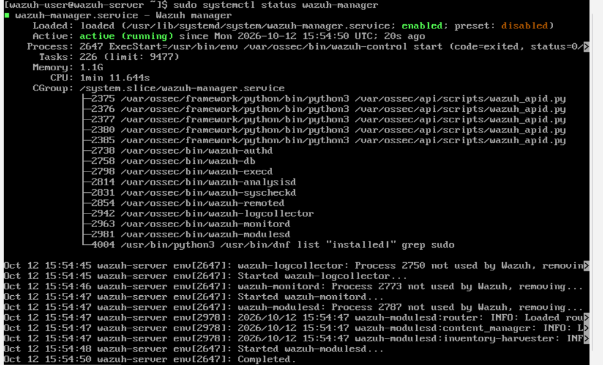
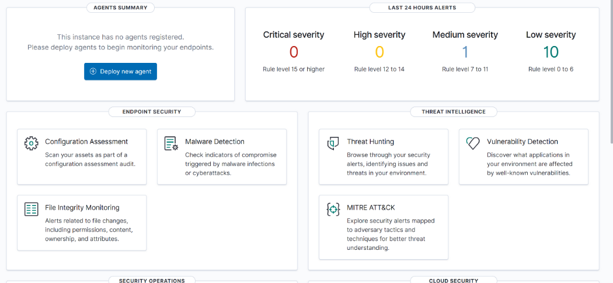
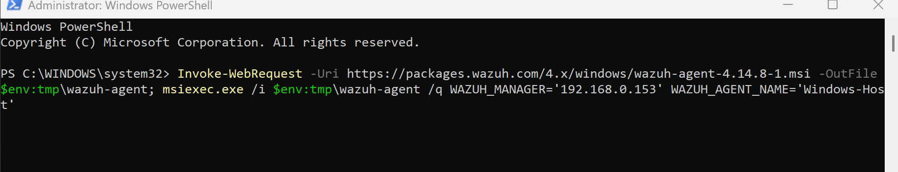
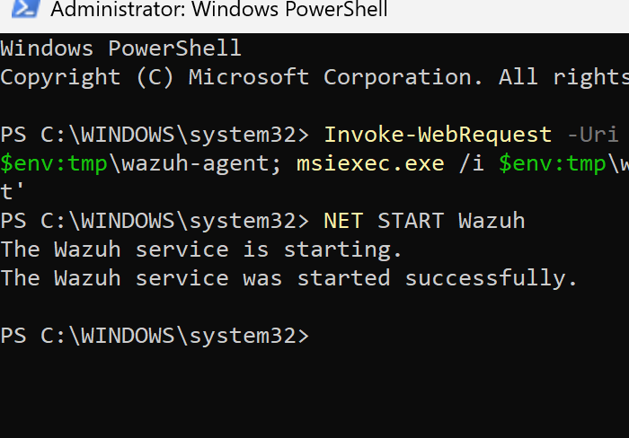
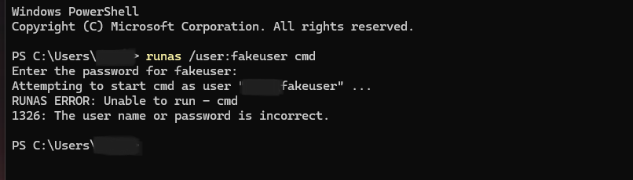

# Wazuh Home Lab – Deploying a SIEM and detecting a failed login

## Introduction

I set up Wazuh, an open-source cybersecurity platform, in a home lab. I fixed a startup failure that left its API offline, connected my Windows 11 PC as a monitored endpoint, and deliberately failed a login to confirm detection.

## Lab setup

- Windows 11 PC running the Wazuh agent
- Wazuh 4.14.8 OVA in VirtualBox

## Problem – Wazuh dashboard showing "No API available to connect"

I logged into Wazuh using the `ip a` command in the Wazuh terminal, then opened my Windows browser and entered the "inet" IP. However, the dashboard reported "no API connection".

When researching this, I learnt that one of the Wazuh components was inactive or something was blocking it. I ran `sudo systemctl status wazuh-manager`, and it showed `failed (Result: timeout)`, meaning the manager wasn't running.

From my understanding, the manager likely started before the indexer, the database component Wazuh depends on, was ready and timed out while waiting. However, once the system had finished loading, I ran `sudo systemctl restart wazuh-manager`. The status changed to `active (running)`, and the dashboard then connected.

## Deploying the agent

I generated the install command from the dashboard's **Deploy New Agent** page and ran it in PowerShell as administrator.

Then I started the service with `NET START Wazuh`. The agent appeared as Active in Endpoints Summary.

## Detection Test

To see whether Wazuh would catch a failed login, I ran the command `runas /user:fakeuser cmd` and entered a wrong password.

In the Wazuh dashboard, Wazuh logged the event at 17:19:11 as rule 60122 "Logon Failure - Unknown user or bad password". In conclusion, Wazuh captured the event I created intentionally.

## What I learned

From this experience, I learned how to download and set up Wazuh and troubleshoot when something doesn't work properly. I fixed the disconnected API and then deployed an agent to monitor my Windows computer for anomalies.

## Next Steps

Deploy the Linux agent on my Kali VM, run failed SSH logins from it, and detect them in Wazuh.
